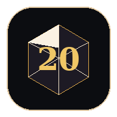

# Solo Quest

A solo tabletop RPG that you play in the browser, with **Claude as the live
Dungeon Master**. Create a hero, make choices in plain language, roll a d20 when
the stakes are high, and watch the story react. Combat is grounded in the open
**D&D 5e SRD** so monsters use their real stat blocks.

It's a **PWA** — installable on phone and desktop, works offline for reading
(new narration needs a connection).



## How it's put together

There are two pieces, because a static site can't safely hold an API key:

1. **The app** — a single-page PWA (`index.html` + assets). Static. Lives on
   GitHub Pages (or any static host).
2. **The DM proxy** — a tiny **Cloudflare Worker** (`worker/`) that stores your
   Anthropic API key as a secret and forwards requests to Claude. The browser
   talks to the Worker, never to Anthropic directly, so your key stays private.

```
Browser (PWA)  ──►  Cloudflare Worker (holds key)  ──►  Anthropic Messages API
```

## Quick start

### 1. Deploy the DM proxy (Cloudflare Worker — free tier is plenty)

You need an [Anthropic API key](https://console.anthropic.com/) and a free
[Cloudflare account](https://dash.cloudflare.com/).

```bash
cd worker
npm install -g wrangler          # or: npx wrangler ...
wrangler login
wrangler secret put ANTHROPIC_API_KEY   # paste your key when prompted
wrangler deploy
```

Wrangler prints your Worker URL, e.g. `https://solo-quest-dm.<you>.workers.dev`.
Copy it.

### 2. Point the app at your Worker

Open `index.html` and edit the two config lines near the top of the `<script>`:

```js
const DM_ENDPOINT = "https://solo-quest-dm.<you>.workers.dev";  // your Worker URL
const MODEL = "claude-sonnet-5";   // any current model id (see note below)
```

### 3. Publish the app on GitHub Pages

- Create a repo, push these files to it.
- Repo **Settings → Pages → Build and deployment → Source: Deploy from a branch**,
  pick `main` / root, save.
- Your site appears at `https://<you>.github.io/<repo>/`.

### 4. Lock the Worker to your site (important)

By default the Worker accepts requests from anywhere, meaning anyone could spend
your credits. Set `ALLOWED_ORIGIN` in `worker/wrangler.toml` to your site URL and
redeploy:

```toml
[vars]
ALLOWED_ORIGIN = "https://<you>.github.io"
```
```bash
cd worker && wrangler deploy
```

Done — open your site and start a tale.

## Configuration

| Where | Setting | Notes |
|---|---|---|
| `index.html` | `DM_ENDPOINT` | Your Worker URL, or `/api/dm` if you host both on the same origin. |
| `index.html` | `MODEL` | A current Claude model id. Model names change over time — check the latest list at https://docs.claude.com/en/docs/about-claude/models |
| `index.html` | `MAX_TOKENS` | Cap per DM reply (default 1200). |
| `wrangler.toml` | `ALLOWED_ORIGIN` | Comma-separated site origins allowed to call the Worker. Keep this tight. |

**Cost:** every turn is one Messages API call billed to *your* key. Sonnet-class
models are cheap for this; a long session is typically cents. Watch your usage in
the Anthropic console.

## SRD monster grounding

When the DM references a creature that exists in the SRD, the app injects that
creature's real stat block (AC, HP, attacks, CR) into the prompt so combat stays
consistent and rules-accurate. Toggle it any time under **☰ → Settings → SRD
monster grounding**.

The SRD covers **rules, monsters, spells, conditions, items** — not published
setting lore (Forgotten Realms cities, named NPCs, adventures), which remains
Wizards of the Coast's copyright. So worlds, cities and plots are Claude's own
invention; the mechanics are sourced.

Want more grounding? The [5e-database](https://github.com/5e-bits/5e-database)
also has `5e-SRD-Spells.json`, `5e-SRD-Conditions.json`, `5e-SRD-Equipment.json`
etc. Drop them in `data/` and extend the matching logic in `srdBlock()`.

## Saving & storage

Tales are saved locally in the browser, no account needed:

- **Full tale bodies** live in **IndexedDB** (large quota, async writes, no UI jank on long campaigns). A story keeps its transcript once, not twice, so it stays compact.
- **A small index** of tale summaries lives in `localStorage` so the start screen renders instantly.
- If IndexedDB is unavailable (e.g. private-browsing mode), it falls back to `localStorage` automatically.
- If a save ever fails, a visible banner warns you — no more silent data loss.

Nothing leaves the device except the DM prompt itself (sent to your Worker → Anthropic).

## Story length & endings

An AI DM left alone will meander forever, so Solo Quest gives the story a shape.
At creation you pick a **length**:

- **One-shot** (~15 scenes), **Standard** (~30 scenes), or **Campaign** (open-ended, told as chained chapters).

The DM is fed a hidden "story clock" each turn — which act it's in (setup → rising
action → midpoint → escalation → climax → resolution) based on **scene count, not
wall-clock time** (so bursty play doesn't break pacing). It escalates as the arc
matures and steers toward a climax when the story has earned one, without cutting
you off mid-action. You can also force it: **☰ → Wind toward an ending** tells the
DM to start converging now. When a tale resolves, you can **begin a new chapter**
with the same hero (keeps level/gear, resets the arc) or retire them.

## Alternative: one-origin deploy (Cloudflare Pages)

If you'd rather not run a separate Worker domain, host the static files on
**Cloudflare Pages** and put the proxy in a Pages Function at
`functions/api/dm.js` (same code as `worker/worker.js`). Then set
`DM_ENDPOINT = "/api/dm"` and CORS stops mattering (same origin).

## Files

```
index.html              the whole app (UI + game logic + DM transport)
manifest.webmanifest    PWA manifest
sw.js                   service worker (offline app shell)
icons/                  app icons + favicon
data/srd-monsters.json  334 SRD monster stat blocks (CC-BY-4.0)
data/ATTRIBUTION.txt    required SRD attribution
worker/worker.js        Cloudflare Worker DM proxy
worker/wrangler.toml    Worker config
```

## Licenses

- App code: **MIT** (see `LICENSE`).
- Monster data: **CC-BY-4.0**. You must keep the attribution — see
  `data/ATTRIBUTION.txt`:

> This work includes material taken from the System Reference Document 5.1
> ("SRD 5.1") by Wizards of the Coast LLC and available at
> https://dnd.wizards.com/resources/systems-reference-document. The SRD 5.1 is
> licensed under the Creative Commons Attribution 4.0 International License
> available at https://creativecommons.org/licenses/by/4.0/legalcode.
